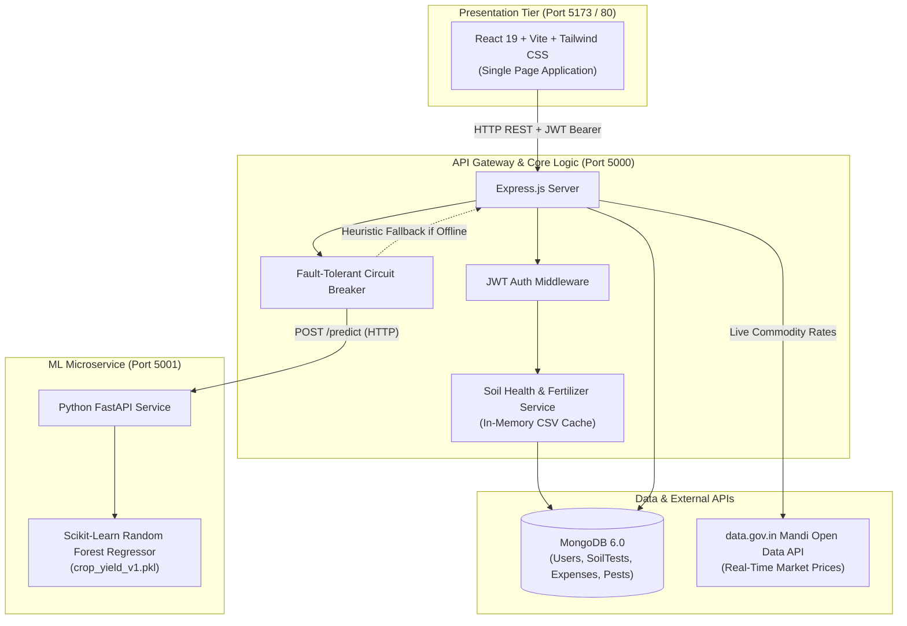

# 🌱 Smart Agriculture Management System

[](https://react.dev/)
[](https://nodejs.org/)
[](https://fastapi.tiangolo.com/)
[](https://www.mongodb.com/)
[](https://www.docker.com/)
[](https://tailwindcss.com/)
[](https://opensource.org/licenses/MIT)

> An enterprise-grade, polyglot full-stack agritech platform designed to empower farmers with automated **soil health diagnostics**, **scientific fertilizer prescriptions**, **real-time government mandi pricing**, and **AI-driven crop yield predictions**.

### 🚀 Live Cloud Deployments
- 🌐 **Web Application:** [https://smart-agriculture-management-system-three.vercel.app](https://smart-agriculture-management-system-three.vercel.app)
- 🔌 **Backend REST API:** [https://smart-agri-backend-ole9.onrender.com](https://smart-agri-backend-ole9.onrender.com)
- 🤖 **FastAPI ML Service:** [https://smart-agri-ml.onrender.com](https://smart-agri-ml.onrender.com)
- 🗄️ **Database:** MongoDB Atlas M0 Cluster (`smart_agri`)

---

## 🏛️ System Architecture

The platform uses a decoupled microservices architecture combining the high-concurrency I/O performance of **Node.js** with the machine learning capabilities of **Python**:



---

## ✨ Key Engineering Highlights

1. **Polyglot Microservices Communication**:
   * Decoupled Node.js REST API and Python FastAPI service communicating via asynchronous HTTP with strict Pydantic JSON schemas.
2. **Resilient Circuit-Breaker Heuristics**:
   * In [backend/services/model.service.js](backend/services/model.service.js), an 8-second circuit-breaker timeout protects the user experience. If the Python ML microservice is unreachable, the system activates a mathematical heuristic fallback instead of returning a 500 server error.
3. **Scientific Soil Scoring Algorithm (0–100)**:
   * Multi-criteria weighted formula: $\text{HealthScore} = (N \times 0.30) + (P \times 0.25) + (K \times 0.25) + (\text{pH} \times 0.20)$ with automated fertilizer dosage prescriptions (Urea, DAP, MOP, Lime $\text{CaCO}_3$, Gypsum).
4. **Sub-Millisecond Regional Fuzzy Matching**:
   * Pre-caches 500+ Indian district soil records from CSV into in-memory arrays on startup, eliminating repetitive disk/database overhead.
5. **Robust Security & Stateless Auth**:
   * Passwords cryptographically salted and hashed using `bcryptjs`. Session authorization implemented via signed JSON Web Tokens (JWT) verified through reusable Express middleware.
6. **Containerized Production Setup**:
   * Ready for one-command orchestration with multi-stage Docker builds and `docker-compose.yml`.

---

## 📁 Repository Structure

```
Smart-Agriculture-management-system/
├── backend/                  # Node.js + Express REST API Gateway
│   ├── config/              # Configuration loaders and environment binding
│   ├── controllers/         # Request input parsing and HTTP responses
│   ├── data/                # Regional soil & crop ideal NPK CSV datasets
│   ├── middleware/          # JWT authorization guards and validators
│   ├── models/              # Mongoose schemas (User, SoilTest, Expense, Pest)
│   ├── routes/              # Express API route endpoints
│   ├── services/            # Core business logic (Soil scoring, Model proxy)
│   ├── server.js            # Express application bootloader
│   └── Dockerfile           # Alpine Node.js production image
│
├── ml-service/               # Python Machine Learning Microservice
│   ├── data/                # Agricultural training dataset (crop_500_dataset.csv)
│   ├── ml/                  # Model training, feature pipeline, and inference
│   │   ├── train.py         # Scikit-learn Random Forest regression trainer
│   │   ├── predict.py       # Joblib inference engine
│   │   └── features.py      # Feature engineering and data cleaning
│   ├── app.py               # FastAPI application with /predict and /train
│   └── Dockerfile           # Python 3.11 slim production image
│
├── smart-agro/               # Modern React 19 Client Dashboard
│   ├── src/
│   │   ├── components/      # UI components (Dashboard, Forms, Navigation)
│   │   ├── pages/           # Views (SoilDashboard, ExpenseDashboard, PestDashboard)
│   │   ├── api.js           # Centralized Axios client with JWT request interceptor
│   │   └── AuthContext.jsx  # Global authentication React context provider
│   ├── nginx.conf           # Production Nginx reverse proxy configuration
│   └── Dockerfile           # Multi-stage Vite build + Nginx production image
│
├── docker-compose.yml        # Orchestrates Mongo + Node + FastAPI + React
├── DEPLOYMENT.md             # Free cloud hosting deployment walkthrough
└── README.md
```

---

## 📡 API Reference Overview

| Method | Endpoint | Description | Protected |
| :--- | :--- | :--- | :---: |
| `POST` | `/api/auth/register` | Register a new farmer account (bcrypt hashed) | No |
| `POST` | `/api/auth/login` | Authenticate user & receive signed JWT | No |
| `POST` | `/api/soil/analyze` | Run dual-mode soil analysis (region fuzzy or manual NPK/pH) | Optional |
| `GET` | `/api/soil/history` | Retrieve paginated soil test history for user | Yes |
| `POST` | `/api/predict/yield` | Proxies yield prediction to Python ML microservice | Yes |
| `GET` | `/api/market` | Fetches live government mandi prices via `data.gov.in` | No |
| `GET` | `/api/expenses` | List farm ledger records and financial totals | Yes |
| `POST` | `/api/expenses` | Create seed/fertilizer/labor expense record | Yes |
| `GET` | `/api/pests/catalog` | Search pest & crop disease identification catalog | No |

---

## ⚡ Quick Start

### Method 1: Using Docker Compose (Recommended)

Ensure [Docker Desktop](https://www.docker.com/products/docker-desktop/) is installed and running, then execute from the project root:

```bash
docker compose up --build
```

Access the services:
* **Frontend Dashboard**: `http://localhost:5173`
* **Node.js API**: `http://localhost:5000`
* **FastAPI ML Microservice Docs**: `http://localhost:5001/docs`

---

### Method 2: Local Manual Setup

#### Prerequisites
* **Node.js**: v18+
* **Python**: v3.10+
* **MongoDB**: Running locally at `mongodb://127.0.0.1:27017`

#### 1. Setup Backend
```bash
cd backend
cp .env.example .env
npm install
npm run dev
```

#### 2. Setup Machine Learning Microservice
```bash
cd ml-service
python -m venv venv
# Windows:
.\venv\Scripts\activate
# Linux/Mac:
source venv/bin/activate

pip install -r requirements.txt
python -m ml.train
uvicorn app:app --port 5001 --reload
```

#### 3. Setup Frontend
```bash
cd smart-agro
npm install
npm run dev
```
Open **`http://localhost:5173`** in your browser.

---

## 🌐 Production Deployment

Refer to [DEPLOYMENT.md](DEPLOYMENT.md) for a comprehensive, zero-cost walkthrough on deploying:
* **Frontend** $\rightarrow$ [Vercel](https://vercel.com)
* **Backend & ML Microservice** $\rightarrow$ [Render](https://render.com)
* **Database** $\rightarrow$ [MongoDB Atlas](https://www.mongodb.com/cloud/atlas)

---

## 📜 License

This project is licensed under the [MIT License](LICENSE).
